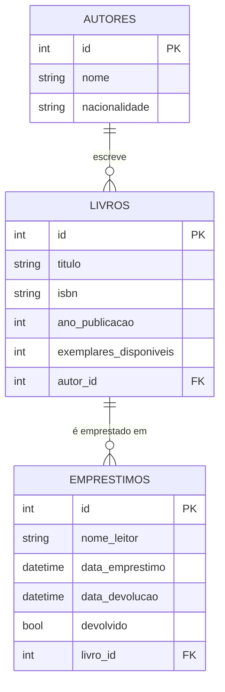

# API Biblioteca

Trabalho Prático 03 — Arquitetura de Software (ADS, Bloco IV, 2026.2)

**Integrantes:** _(preencher com os nomes do grupo, máximo 6)_

## 1. Modelo de negócio

Sistema de gerenciamento de uma **biblioteca**: cadastro de autores, do acervo de livros e
controle de empréstimos. Cada empréstimo reduz o número de exemplares disponíveis do livro, e a
devolução o restaura.

## 2. Entidades e relacionamentos

| Entidade | Atributos |
|---|---|
| **Autor** | id, nome, nacionalidade |
| **Livro** | id, titulo, isbn (único), ano_publicacao, exemplares_disponiveis, autor_id (FK) |
| **Empréstimo** | id, nome_leitor, data_emprestimo, data_devolucao, devolvido, livro_id (FK) |



- Um autor tem vários livros (`Autor.livros` ↔ `Livro.autor`).
- Um livro tem vários empréstimos (`Livro.emprestimos` ↔ `Emprestimo.livro`).

## 3. Estrutura do projeto

```
app/
├── main.py            # instancia o FastAPI e registra os routers
├── core/              # config (settings) e database (engine, Base, get_db)
├── models/            # modelos SQLAlchemy
├── schemas/           # schemas Pydantic (Create / Update / Response)
└── routers/           # endpoints por recurso
alembic/               # ambiente e migrations versionadas
```

## 4. Instalação e execução

```bash
python -m venv .venv
source .venv/bin/activate        # Windows: .venv\Scripts\activate
pip install -r requirements.txt

alembic upgrade head             # cria o banco via migrations
uvicorn app.main:app --reload
```

Swagger: http://127.0.0.1:8000/docs

Por padrão usa SQLite (`biblioteca.db`). Para outro banco, defina `DATABASE_URL` em um `.env`.
O banco é criado **exclusivamente** pelas migrations. Para alterar os models:
`alembic revision --autogenerate -m "descrição"` e depois `alembic upgrade head`.

## 5. Endpoints

| Método | Rota | Descrição | Status |
|---|---|---|---|
| POST | `/autores/` | Cria autor | 201, 422 |
| GET | `/autores/` | Lista autores | 200 |
| GET | `/autores/{id}` | Busca autor | 200, 404 |
| PUT | `/autores/{id}` | Atualiza autor | 200, 404, 422 |
| DELETE | `/autores/{id}` | Remove autor (bloqueia se tiver livros) | 204, 404, 409 |
| POST | `/livros/` | Cria livro (valida autor e ISBN único) | 201, 404, 409, 422 |
| GET | `/livros/` | Lista livros (filtro `autor_id`) | 200 |
| GET | `/livros/{id}` | Busca livro | 200, 404 |
| PUT | `/livros/{id}` | Atualiza livro (valida novo autor) | 200, 404, 422 |
| DELETE | `/livros/{id}` | Remove livro (bloqueia se tiver empréstimos) | 204, 404, 409 |
| POST | `/emprestimos/` | Cria empréstimo (valida livro e estoque) | 201, 404, 409, 422 |
| GET | `/emprestimos/` | Lista empréstimos (filtro `devolvido`) | 200 |
| GET | `/emprestimos/{id}` | Busca empréstimo | 200, 404 |
| PUT | `/emprestimos/{id}` | Atualiza nome do leitor | 200, 404, 422 |
| PATCH | `/emprestimos/{id}/devolver` | Registra devolução e repõe estoque | 200, 404, 409 |
| DELETE | `/emprestimos/{id}` | Remove empréstimo | 204, 404 |

## 6. Regras de integridade

- Criar/atualizar livro verifica se o `autor_id` existe (404 caso contrário).
- Criar empréstimo verifica se o `livro_id` existe (404) e se há exemplares (409).
- Chaves estrangeiras também são aplicadas pelo banco (`PRAGMA foreign_keys=ON` no SQLite).
